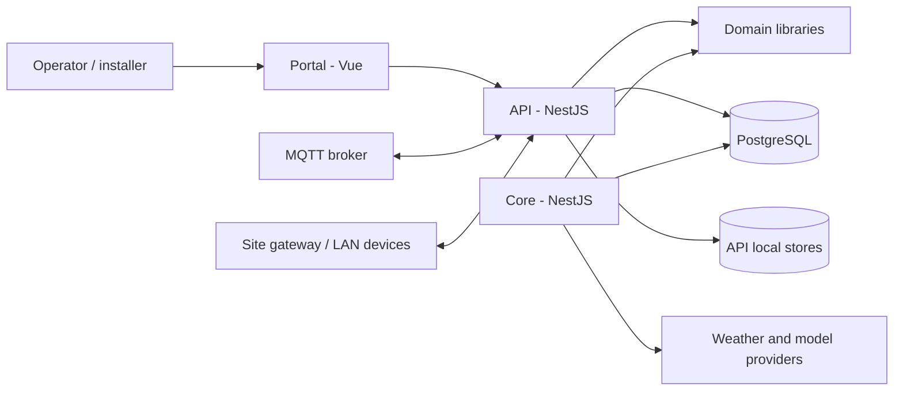

# Architecture overview

## Product shape

Energrid is one local-first platform for residential and commercial installations. The repository uses the same domain libraries and Core services for both; it does not define separate residential and commercial cores. Per-site configuration and workflows provide installation-specific behavior.

The API and Core are separate NestJS applications. The Portal is a Vue/Vite application. Device integrations live in the API's adapters and services; shared deterministic rules belong in the domain libraries when they can remain framework- and transport-independent.

## Repository applications and libraries

| Area | Responsibility visible in this checkout |
| --- | --- |
| `apps/api` | NestJS API, Portal routes/context, device registry and control, MQTT/HTTP integration, auth, telemetry ingress, account-scoped personal expenses, and local stores. |
| `apps/core` | NestJS Core HTTP app; estimator, installations, forecasts, weather and Core PostgreSQL migrations. |
| `apps/portal` | Vue 3/Vite browser UI; calls API routes and does not own device identity or authorization decisions. |
| `apps/api-e2e` | API end-to-end test project. |
| `libs/domain-devices` | Framework-independent device identity, enrollment and observation/diagnostic domain behavior. |
| `libs/domain-telemetry` | Telemetry validation, measurement semantics and aggregation helpers. |
| Other `libs/*` | Automation, voice, shared types and shared utilities; see each library README. |
| `packages/stt-stream-*` | Workspace packages for voice streaming providers and their shared contract. |
| `device-scripts/` | Local operational scripts, simulated site devices and the Device Lab. |
| `deploy/` | Checked-in deployment examples/configuration, including site gateway and Mosquitto materials. |

Project definitions: [`apps/api/project.json`](../apps/api/project.json), [`apps/core/project.json`](../apps/core/project.json), [`apps/portal/project.json`](../apps/portal/project.json), and [`nx.json`](../nx.json). The root [package scripts and dependencies](../package.json) define local commands.

Nx discovers projects from `project.json` and inferred plugin targets in `nx.json`. The root `package.json` contains runtime and development commands. There is no separate production Core package boundary implied by the Nx layout.

## System context

The diagram shows repository-level relationships, not a deployment guarantee. API and Core database connections are configured independently; a particular deployment may use the same or separate PostgreSQL databases. Provider calls and LAB-only features are opt-in/configuration-dependent.

## Deployed authority and isolated development

Each deployed site has one designated inventory/observation authority and canonical state writer. Local development is an isolated instance even when its tenant/site labels match Home. `ENERGRID_INSTANCE_ID` and `ENERGRID_INSTANCE_MODE` make the intended role visible in configuration and the administrator-only runtime diagnostic; the current diagnostic is not an attestation or uniqueness-enforcement mechanism. The Mac development API and Pi 5 Home API currently use separate PostgreSQL databases and separate local stores. They are not replicas, and their independently generated Physical Inventory IDs must not be copied between them. The Pi 5 remains the proposed Home authority; the M0 source change does not migrate or deploy it.

Network observers provide evidence under an exact site/scope authorization. They do not own enrollment, observation authority, canonical state, or control policy. The current API-owned SSH stdio worker is a read-only pull mechanism for its existing Shelly switch-state path. There is not yet a general authenticated machine-reporting boundary for remote observers to submit evidence or electrical observations to a designated site Core. The operator-attested Portal evidence workflow and internal observation ingress are not substitutes for that boundary. See [ADR 0005](decisions/0005-background-ingestion-ownership.md) and [Collection and ingestion](collection-and-ingestion.md#selected-device-evidence-refresh-and-em1-approval-preflight-local-source-5-november-2026).

## Dependency boundaries

- Domain libraries should carry deterministic rules and typed contracts, without NestJS, SQL, MQTT or network clients. Enrollment uses a repository port; the API supplies the PostgreSQL adapter.
- API application services coordinate domain rules with protocol adapters and persistence.
- Inbound adapters translate transport evidence into typed inputs. Transport reachability alone is not device identity, enrollment, observation approval or control authorization.
- Core owns its HTTP application and forecast/estimator behavior. The checked-in Core migration directory also contains shared auth, device-inventory and telemetry schemas used by the API; migration ownership is in `apps/core/migrations`, not proof that the API imports Core services.
- The Portal carries user interaction. Site scope and administrative access are resolved and enforced server-side.
- Personal expenses are account-scoped rather than site-scoped. Their authenticated API and dedicated local store remain separate from energy telemetry and device inventory.

## Current-state boundary

This overview's current-state reconciliation is local main `dbf63c26` (2 November 2026), not a deployment claim. Implemented capabilities, runtime evidence and known gaps are summarized in the [audit and remaining gaps](audit-and-gaps.md). Device Health V1 query behavior is implemented and documented in [Device Health history](device-health-history.md); that does not imply deployment on any particular host.
