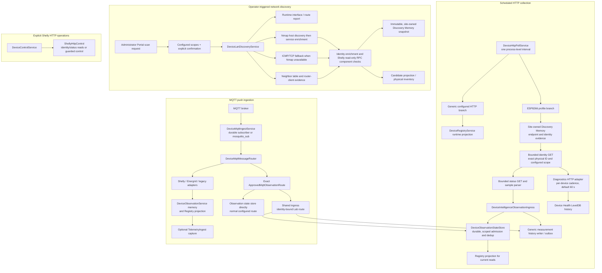

# Collection and ingestion architecture

## Status and scope

This chapter records the implementation visible in the committed Energrid source at `558c6d3` and the architecture audit performed against it. It describes source behavior; it does not prove that a particular API process has loaded that source or that a live device is reachable. The documentation worktree is based on `6bd4b5f`; comparison with `558c6d3` found no intervening changes to the collection paths described below. Device Health query and Portal documentation changed in the later source history and should be read from their own guides.

The active main checkout also contains **uncommitted observer-reachability work** in `DeviceHttpPollService`, `DeviceRegistryService`, the Device Health view and related tests/docs. This work is **in progress and unverified here**. The committed behavior described below remains authoritative until that work is committed and reviewed. It is not represented as shipped behavior in this chapter.

## Current collection map

The diagram intentionally separates **collection** from **discovery** and **control**. A successful scan does not schedule routine polling, authorize an observation, enroll a candidate or authorize a switch command.

## Scheduled HTTP polling

`DeviceHttpPollService` owns the one application-level HTTP timer. `HOME_HTTP_POLL_ENABLED` enables it; `HOME_HTTP_POLL_INTERVAL_MS` defaults to 5 seconds (minimum accepted value 500 ms). Each cycle enumerates approved installations across sites, selects configured HTTP targets and invokes the appropriate branch. It runs once immediately at module startup and clears its interval during module destruction.

The service uses a process-local `polling` flag to skip a timer tick while the previous full cycle is still running. It does **not** cap device-level concurrency: eligible devices are collected with `Promise.all`. There is no per-device plan, retry schedule, exponential backoff or jitter. A failed request is normally observed again on a later interval. The default HTTP timeout is 2 seconds (`HOME_HTTP_POLL_TIMEOUT_MS`, with a 250 ms minimum).

### Generic configured HTTP branch

For non-Energrid HTTP adapters, the poller fetches the configured target, normalizes simple JSON values and updates the registry's runtime telemetry/status projection. It does not perform the ESP identity/discovery-memory sequence or submit through `DeviceIntelligenceObservationIngress`. In the committed implementation, a non-success response or thrown request error sets registry status to `offline`. This is a different failure contract from the identity-aware path and should not be read as independently verified physical-device health.

### Energrid ESP8266 branch

The ESP profile derives tenant/site and expected physical identity from the registered installation. It reads identity evidence only within the device's configured network zone, resolves the enrolled target, and makes a bounded identity request before status collection. Redirects are rejected, identity must match exactly, response bodies are bounded, and a mismatch is not admitted as telemetry. Once identity is accepted, the status response is parsed and submitted with a deterministic sample/evidence ID to `ApprovedMqttObservationRuntime.ingestHttpObservation`; installation authority and approval are checked again in the ingress.

At committed `558c6d3`, a polling transport error or identity/status HTTP error before the observation phase writes `offline` to registry state; identity mismatch and missing/out-of-scope endpoint paths are handled as `unknown`/rejected. The active, uncommitted observer-reachability change is intended to separate the Mac observer's ability to reach a target from the device's own health. It has not yet replaced this committed behavior.

## Firmware diagnostics and Device Health

Diagnostics are not a second polling service. The ESP branch claims a per-device cadence in an in-memory map and, by default, calls the separate `EnergridFirmwareDiagnosticsHttpAdapter` about once per minute. The interval can be configured from 15 seconds to 15 minutes with `HOME_FIRMWARE_DIAGNOSTICS_INTERVAL_MS`. The diagnostics request uses the already identity-verified HTTP origin, a bounded read-only GET, timeout and response size, then checks the physical ID and typed diagnostics schema.

`DeviceFirmwareDiagnosticsService` writes timestamped snapshots, communication failures and derived events/rollups into its own LevelDB store (default `~/.energrid/device-firmware-diagnostics`). Keys and queries include tenant, site and logical device identity; the sample must also match the expected ESP8266 physical ID. Failures append separately and retain the last successful snapshot. The current diagnostics contract and parser are ESP8266-specific; the durable health history/query boundary is documented in [Device Health history V1](device-health-history.md).

The cadence map is process memory, so an API restart resets the due-time and may cause an early next diagnostics collection. Stored history is durable across restart; the scheduler's prior due-time is not. No device-side command is issued by diagnostics collection.

## MQTT push ingestion

`DeviceMqttIngestService` owns subscriber startup and shutdown. It first recovers configured approved observation state. The isolated Lab path requires an exact configured route and a loopback MQTT endpoint. The normal path builds subscriptions from the inbound adapters, configured approved routes and evidence capture. If durable telemetry is enabled it uses `DurableMqttSubscriber`; otherwise it starts `mosquitto_sub` as a child process.

The durable subscriber requests QoS 1 with a stable persistent client ID and `clean: false`. It acknowledges after its receive callback resolves, and closes without PUBACK after a receive failure so the broker can redeliver. Reconnection and the post-failure retry delay are fixed at five seconds; the connect timeout is ten seconds. This is bounded delivery/retry behavior, not the HTTP poller's retry policy. QoS 0 messages cannot receive the same redelivery guarantee.

`DeviceMqttMessageRouter` selects protocol adapters, including Shelly, Energrid and legacy adapters. The Shelly adapter derives the protocol identity from a Shelly message ID/topic and parses observed `switch`, `em1` and `em1data` component payloads. It can create discovery evidence, but the router checks enrollment before applying telemetry effects. A payload claim is not by itself proof of a broker-observed physical endpoint.

### Shared ingress and paths that bypass it

`DeviceIntelligenceObservationIngress` is the protocol-independent deterministic observation boundary: it resolves the approved installation and enrollment for the supplied tenant/site, verifies the source/selector authority, passes the observation to the durable state store, assigns server receipt time and sends accepted evidenced measurements to the generic history writer/outbox.

HTTP ESP observations use this boundary. The explicitly identity-bound Lab MQTT route is also wired through it, allowing cross-transport evidence IDs and the same history writer.

Not every MQTT path currently uses that ingress:

- `ApprovedMqttObservationRuntime` constructs the normal configured MQTT route without injecting the shared ingress. Its direct configured-binding branch validates exact scope, enrolled/approved device and installation, then calls the observation state store directly and projects accepted state to the registry; it does not pass through the ingress's generic history-writer hook. If a normal route is configured with `expectedDeviceIdentity`, that branch requires the missing ingress and fails closed instead of entering the common history path.
- Adapter-driven MQTT messages that do not match an exact approved route can update the legacy in-memory `DeviceObservationService` and the Registry. `TelemetryIngestService.capture` is optional and is a different path from the common ingress/outbox.

These routes preserve useful existing contracts, but they do not yet provide one uniform persistence/history path. See ADR [0002](decisions/0002-shared-observation-rules.md) and the open issues below.

## Operator-triggered LAN discovery

Discovery is initiated through the administrator Portal `POST network/scan` operation. The request must select configured scopes and explicitly confirm a full-subnet scan. Server-side scope validation is repeated in `DeviceLanDiscoveryService`; the scan captures its tenant/site owner from the authorized server context at start. A network scope ID describes the scanned network, not site ownership.

The collector gathers runtime interface/route evidence, Nmap capability, host discovery and service enrichment when enabled/available, neighbor table and router-client candidates. Nmap service enrichment is limited to discovered hosts and in-scope configured seeds; it shares the scan deadline and keeps host evidence if enrichment is incomplete. If Nmap is unavailable, bounded ICMP and TCP fallback probes run. Results are normalized and enriched, then persisted as immutable, owner-scoped Discovery Memory snapshots and projected into candidate/physical inventory workflows. A route/interface observation does not itself authorize scanning that network.

Shelly Gen2+ enrichment includes a bounded read-only `Shelly.GetComponents`/`Shelly.GetStatus` path and verifies component status before recording a supported `switch:x` or `em1:x` candidate. This is scan-time evidence; it is not periodic Shelly polling.

## Tenant, site, scope and identity

Background ESP polling uses each persisted installation's explicit tenant/site and network-scope metadata; it does not rely on the Portal's currently selected site. Discovery separates server-authorized snapshot ownership from configured network scope. Approved observation ingress checks that the device, enrollment and installation match the supplied scope. Exact topics and scope are held in trusted approved MQTT binding configuration rather than accepted from payload-supplied site IDs.

One area needs additional care: generic adapter-driven background MQTT routing obtains the registry snapshot's tenant/site for discovery and legacy effects. Background subscriber callbacks have no Portal request context and therefore fall back to configured site context. Exact approved routes carry explicit scope; generic MQTT discovery/legacy routing should not be treated as a complete multi-site broker-to-site binding. See ADR [0005](decisions/0005-background-ingestion-ownership.md).

## Observer reachability and device health

These are separate concepts:

- **Observer reachability**: a particular collector could or could not reach a particular endpoint from its current interface/network vantage at a stated time.
- **Device status/health**: evidence reported by the device or derived from authenticated, identity-verified device responses.
- **Measurement freshness**: when an accepted sample was measured/received and whether it is recent.

At committed `558c6d3`, the observer-relative reachability model is not yet represented consistently by the generic HTTP/ESP poll paths; HTTP failures may set status to offline. The uncommitted main-checkout work adds observer metadata to reachability/failure state and Portal presentation. It is still **in progress**, is not part of this documentation commit's implementation baseline, and should be re-audited after it is committed. No timeout from one observer proves power loss or Wi-Fi disconnection. See ADR [0004](decisions/0004-observer-reachability.md).

## Outages, restarts and data recovery

- An HTTP poller restart stops and recreates its process-local interval; the first enabled startup tick runs immediately. The cadence/overlap state is not shared across processes.
- A device/network timeout does not erase the previous successful firmware diagnostic snapshot. When a diagnostics collection attempt is due, its failure is recorded separately with collection time/reason; the diagnostics cadence means not every ordinary five-second poll failure creates a diagnostics-history event. Device Health history is stored in LevelDB and can be queried after API restart.
- Durable MQTT handling can rely on broker redelivery for unacknowledged QoS 1 delivery after receive/admission failure. The normal `mosquitto_sub` fallback has no equivalent application-controlled PUBACK-after-commit contract.
- The durable observation store and generic measurement outbox allow accepted readings to survive a PostgreSQL interruption and replay later, subject to their capacity and recovery policies. A broker reconnect does not itself prove that an observation passed approval or reached measurement history.
- Discovery snapshots are historical records. A failed or incomplete scan does not prove an endpoint is offline and is not a substitute for a current polling attempt.

## Open architecture issues

| Issue | Current source owner | Effect |
| --- | --- | --- |
| Normal configured MQTT route may bypass common ingress and its generic measurement history hook | [`ApprovedMqttObservationRuntime`](../apps/api/src/app/modules/devices/mqtt/approved-mqtt-observation.runtime.ts), [`ApprovedMqttObservationRoute`](../apps/api/src/app/modules/devices/mqtt/approved-mqtt-observation.route.ts) | Approved state can be durable while measurement history semantics differ from HTTP/Lab ingress. |
| Generic background MQTT effects can use default site context | [`DeviceMqttMessageRouter`](../apps/api/src/app/modules/devices/mqtt/device-mqtt-message-router.ts), [`portal-site-context.ts`](../apps/api/src/app/modules/portal/portal-site-context.ts) | Exact configured routes have explicit scope; generic discovery/legacy paths need an explicit device/broker-to-site owner for multi-site operation. |
| HTTP collection has unbounded device-level concurrency and no per-device/capability plan | [`DeviceHttpPollService`](../apps/api/src/app/modules/devices/device-http-poll.service.ts) | Large installations can create request bursts; only a process-local whole-cycle guard prevents overlap. |
| Generic HTTP failure is modeled differently from ESP profile failures | [`DeviceHttpPollService`](../apps/api/src/app/modules/devices/device-http-poll.service.ts) | A timeout can update generic registry status to offline without observer-relative qualification. |
| Poll overlap protection is process-local | [`DeviceHttpPollService`](../apps/api/src/app/modules/devices/device-http-poll.service.ts) | Multiple workers/gateways could duplicate scheduled work without leases/partitioning; idempotent ingress remains important. |

## Intended architecture (roadmap, not implemented)

The smallest future boundary is a typed collection plan and result around the existing poller. A plan would identify authorized tenant/site/device, capability, selected protocol adapter, verified endpoint evidence, requested interval and timeout. The coordinator—not a device-specific service—would enforce bounded concurrency, per-operation overlap, retry/backoff/jitter and lifecycle cancellation. Adapters would gather protocol evidence and return typed outcomes without owning global scheduling or mutating enrollment.

Per-capability intervals and a distributed worker/gateway lease/partition model are future work. The same deterministic observation policy, evidence IDs, state store and history writer should process both scheduled samples and MQTT push messages. Discovery remains a separately authorized operation, and control remains a separately authorized action. None of these roadmap items should be read as implemented by this handbook chapter.

## Implementation anchors

- [HTTP poller](../apps/api/src/app/modules/devices/device-http-poll.service.ts)
- [Device Health diagnostics store and query](../apps/api/src/app/modules/devices/device-firmware-diagnostics.ts)
- [Diagnostics HTTP adapter](../apps/api/src/app/modules/devices/adapters/outbound/network/energrid-firmware-diagnostics-http.adapter.ts)
- [MQTT subscriber lifecycle](../apps/api/src/app/modules/devices/device-mqtt-ingest.service.ts)
- [Durable MQTT subscriber](../apps/api/src/app/modules/devices/mqtt/durable-mqtt-subscriber.ts)
- [MQTT adapter router](../apps/api/src/app/modules/devices/mqtt/device-mqtt-message-router.ts)
- [Shared observation ingress](../apps/api/src/app/modules/devices/device-intelligence-observation-ingress.ts)
- [Approved MQTT observation route](../apps/api/src/app/modules/devices/mqtt/approved-mqtt-observation.route.ts)
- [LAN discovery service](../apps/api/src/app/modules/devices/device-lan-discovery.service.ts)
- [Nmap adapter](../apps/api/src/app/modules/devices/adapters/outbound/network/nmap-network-evidence.adapter.ts)
- [Portal scan authorization](../apps/api/src/app/modules/portal/portal.controller.ts)
- [Shelly HTTP control adapter](../apps/api/src/app/modules/devices/adapters/outbound/shelly-http-control.ts)
