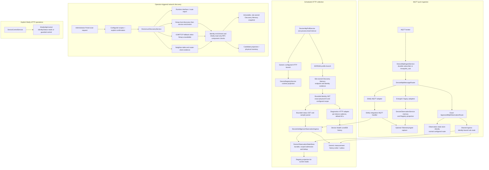

# Collection and ingestion architecture

## Status and scope

This chapter was reconciled against local main `dbf63c26` on 2 November 2026. It describes source behavior and separately records observed Home Portal outcomes; it does not prove that a production API process has loaded this source. Local integration is not deployment. Earlier audit sections are historical snapshots; current gaps are summarized in [Audit and remaining gaps](audit-and-gaps.md).

## Current collection map

The diagram intentionally separates **collection** from **discovery** and **control**. A successful scan does not schedule routine polling, authorize an observation, enroll a candidate or authorize a switch command.

## Scheduled HTTP polling

`DeviceHttpPollService` owns the one application-level HTTP timer. `HOME_HTTP_POLL_ENABLED` enables it; `HOME_HTTP_POLL_INTERVAL_MS` defaults to 5 seconds (minimum accepted value 500 ms). Each cycle enumerates approved installations across sites and dispatches only supported identity-aware collection routes. It runs once immediately at module startup and clears its interval during module destruction.

The service uses a process-local `polling` flag to skip a timer tick while the previous full cycle is still running. It does **not** cap device-level concurrency: eligible devices are collected with `Promise.all`. There is no per-device retry schedule, exponential backoff or jitter. A failed request is normally observed again on a later interval. The default HTTP timeout is 2 seconds (`HOME_HTTP_POLL_TIMEOUT_MS`, with a 250 ms minimum).

`selectScheduledHttpCollection()` now makes the two HTTP scheduling lists explicit in one pure, tested function. Only the identity-aware Energrid ESP8266 adapter can be selected for the general HTTP measurement read; an approved physical Shelly **switch** component can independently be selected for identity-verified operational `Switch.GetStatus`, even when its advertised adapter protocol is MQTT. This selection is only a **candidate schedule**, never source approval or control permission. MQTT subscriptions are configured independently; one device can use multiple transports for different fields. The poller obtains one inventory snapshot per cycle.

The **T1.2a boundary extraction** moves Shelly switch candidate matching and the bounded, identity-checked local `Shelly.GetDeviceInfo` / `Switch.GetStatus` read into `adapters/outbound/network/shelly-switch-collection.adapter.ts`. It does not grant observation authority: `ShellyRouteResolver` still establishes a site-owned endpoint before the adapter is called, and the caller still owns registry projection and observer reachability. JSON response-size handling is shared through a transport helper, not duplicated in the device adapter. The API poller still supervises remote Shelly observers and has a legacy generic `shelly-lan` HTTP branch; T1.2a **does not** enable EM1 power collection or make transport choice entirely binding-driven. This is a staged extraction, not completion of the transport simplification.

**Known EM limitation:** `em1:N` is not scheduled by either switch-status collection or the identity-aware HTTP measurement collector. The legacy `shelly-lan` EM1 HTTP fallback is now disabled rather than attempting to parse a power response as a switch. This does not implement EM1 ingestion. The Shelly integration needs an EM1 parser, identity-verified RPC read and an authorized source/field binding to the existing ingress.

### Shelly read-only operational status

The poller also has an enrolled Shelly switch-status path. It resolves the exact tenant/site-owned physical assignment and component, saved endpoint, configured scope, and matching observer; verifies device identity; then reads `Switch.GetStatus?id=N`. Accepted boolean output is written as operational state through `DeviceRegistryService.ingestDeviceTelemetry`, not as electrical measurement history. The operator-triggered one-shot status endpoint uses the same target validation and writer. Read-only status collection does not require switching permission. A previous scan or IP address alone does not authorize a route.

For an enrolled Shelly whose authorized scope is reachable only from a configured remote site observer, the API can supervise one persistent read-only worker over an authenticated, host-key-verified SSH stdio session. The worker runs on that observer and performs only bounded identity, component-list, and switch-status RPC reads for the exact tenant/site/scope/device/component assignments. It validates its host, interface and directly attached CIDR at session startup. The API validates session, sequence, endpoint, physical identity, component set and observation time again, parses through the same Shelly status parser, and submits accepted state through the canonical registry writer. Observer errors update observer-relative reachability only; they do not invent a relay transition. The worker has bounded concurrency and request timeouts, retries with backoff, and is stopped/recreated with the API-owned SSH session; it is not a separately installed Pi service and does not survive an API stop. API startup begins assignment reconciliation and collection again. No API port is exposed on the Pi and the Pi does not connect to Mac loopback.

This remote worker collects relay operational status only. It does not enroll, reconcile endpoints, authorize measurements, or grant switching/assistant control. Site-local observer authorization is explicit in protected runtime configuration and includes tenant, site, scope/CIDR, interface, physical-ID and component allowlists. Multiple observer entries are selected only by an exact authorized match; ambiguous matches fail closed. The continuous worker is source-implemented and covered by focused tests. On 3 November 2026, after a local API restart, logs showed `pi-upstream-bathroom` start and repeated identity/component-validated results submitted to the canonical writer. The authenticated Home Portal SSE connection remained connected and displayed the Bathroom relay as Off with its update timestamp advancing without reload. A worker-only pause did not make the component stale because the independent configured MQTT source continued updating it. This proves the worker and API recovery path, but not which source supplied each Portal update or the stale transition after all sources stop. This is local development evidence, not a production deployment.

After the registry accepts and projects state for an approved device, it emits a typed, process-local event. The authenticated Portal SSE route filters events to the requesting principal's tenant/site. The Portal reconciles from `/portal/state` on stream readiness/reconnect and applies subsequent ordered events to the affected device. The heartbeat describes stream liveness, not device reachability. The event sequence and stream are in memory; reconnect snapshot reconciliation is the recovery mechanism. Live external-toggle-to-Portal timing and physical Home channel-1 delivery were not demonstrated in the 2 November 2026 runtime check.

### Legacy generic HTTP JSON branch (T1.3c1 compatibility change)

Configured `http-json-sensor` and other unknown HTTP drivers **are not scheduled**. The previous generic `fetch` → `normalizeHttpValues` → `registry.ingestDeviceTelemetry` path was not identity-verified and bypassed installation source/field authority. It also marked a device `offline` on an observer-side HTTP error without verified device health. This fallback has been removed from the generic scheduler; `explainScheduledHttpCollection()` returns `no_trusted_http_integration` for configured HTTP drivers without a supported identity-aware integration. Such configurations remain present in inventory but cannot update live state through this route. Specifically, the legacy `HOME_KITCHEN_TEMP_URL` / `http-json-sensor` demonstration will no longer collect through generic HTTP polling.

This is a **fail-closed behavior change**, not a migration of legacy JSON devices to the approved ingress. A future device integration must establish trusted identity/provenance, normalize its payload, and submit to the existing `DeviceIntelligenceObservationIngress` with persisted installation field/source authority. Do not feed arbitrary JSON into the trusted ingress with a fabricated source ID. The Energrid ESP8266 integration and identity-verified Shelly switch operational routes remain active. The legacy `shelly-lan` HTTP collection method remains in the integration for compatibility but is no longer selected by the generic scheduler (including EM1). It is not a power-measurement integration; do not invoke it as a fallback. Separately, the approved Shelly operational-state writer is not the durable per-field electrical-measurement ingress and requires its own boundary review.

### Energrid ESP8266 branch

The ESP profile derives tenant/site and expected physical identity from the registered installation. It reads identity evidence only within the device's configured network zone, resolves the enrolled target, and makes a bounded identity request before status collection. Redirects are rejected, identity must match exactly, response bodies are bounded, and a mismatch is not admitted as telemetry. Once identity is accepted, the status response is parsed and submitted with a deterministic sample/evidence ID to `ApprovedMqttObservationRuntime.ingestHttpObservation`; installation authority and approval are checked again in the ingress.

At `46f3846`, transport failures in the identity-aware Energrid ESP8266 path record observer reachability separately and do not overwrite the last successful registry values, sample timestamp, source or device status. Failures in the due firmware-diagnostics collection are persisted with observer host/platform, local IPv4 scopes, target endpoint/address, configured network scope, attempt time and known failure category; the last successful diagnostic snapshot is retained. A successful HTTP identity response establishes only that the observer reached an HTTP endpoint; exact identity is still required before status observations are admitted. The legacy generic HTTP path was disabled in T1.3c1; an unknown generic HTTP URL no longer creates an offline state.

## Firmware diagnostics and Device Health

Diagnostics are not a second polling service. The ESP branch claims a per-device cadence in an in-memory map and, by default, calls the separate `EnergridFirmwareDiagnosticsHttpAdapter` about once per minute. The interval can be configured from 15 seconds to 15 minutes with `HOME_FIRMWARE_DIAGNOSTICS_INTERVAL_MS`. The diagnostics request uses the already identity-verified HTTP origin, a bounded read-only GET, timeout and response size, then checks the physical ID and typed diagnostics schema.

`DeviceFirmwareDiagnosticsService` writes timestamped snapshots, communication failures and derived events/rollups into its own LevelDB store (default `~/.energrid/device-firmware-diagnostics`). Keys and queries include tenant, site and logical device identity; the sample must also match the expected ESP8266 physical ID. Failures append separately and retain the last successful snapshot. The collector/parser remain ESP8266-specific. The storage/retention and typed query logic are protocol-independent: `DeviceHealthQueryService` lives in `libs/domain-devices`, the authenticated read adapter is in `apps/api/src/app/modules/portal/portal.controller.ts`, and the record/schema contracts are detailed in [Device Health history V1](device-health-history.md).

The cadence map is process memory, so an API restart resets the due-time and may cause an early next diagnostics collection. Stored history is durable across restart; the scheduler's prior due-time is not. No device-side command is issued by diagnostics collection.

## MQTT push ingestion

`DeviceMqttIngestService` owns subscriber startup and shutdown. It first recovers configured approved observation state. The isolated Lab path requires an exact configured route and a loopback MQTT endpoint. The normal path builds subscriptions from the inbound adapters, configured approved routes and evidence capture. If durable telemetry is enabled it uses `DurableMqttSubscriber`; otherwise it starts `mosquitto_sub` as a child process.

The durable subscriber requests QoS 1 with a stable persistent client ID and `clean: false`. It acknowledges after its receive callback resolves, and closes without PUBACK after a receive failure so the broker can redeliver. Reconnection and the post-failure retry delay are fixed at five seconds; the connect timeout is ten seconds. This is bounded delivery/retry behavior, not the HTTP poller's retry policy. QoS 0 messages cannot receive the same redelivery guarantee.

`DeviceMqttMessageRouter` selects protocol adapters, including Shelly, Energrid and legacy adapters. The Shelly adapter derives the protocol identity from a Shelly message ID/topic and parses observed `switch`, `em1` and `em1data` component payloads. It can create discovery evidence, but the router checks enrollment before applying telemetry effects. A payload claim is not by itself proof of a broker-observed physical endpoint.

### Shared ingress and paths that bypass it

`DeviceIntelligenceObservationIngress` is the protocol-independent deterministic observation boundary: it resolves the approved installation and enrollment for the supplied tenant/site, verifies the source/selector authority, passes the observation to the durable state store, assigns server receipt time and sends accepted evidenced measurements to the generic history writer/outbox.

HTTP ESP observations use this boundary. The explicitly identity-bound Lab MQTT route is also wired through it, allowing cross-transport evidence IDs and the same history writer.

### Measurement-history ownership (5 November 2026)

`telemetry.measurements`, written by `GenericMeasurementHistoryWriter` through its durable outbox and `PostgresGenericMeasurementRepository`, is the canonical raw history for accepted, history-eligible normalized measurements. The Portal generic-history and electrical-chart endpoints and the assistant measurement-history tool use the same `DeviceIntelligenceQueryService.readAuthorizedMeasurementHistory` query. It resolves an enrolled device in the authenticated tenant/site, requires the metric in `readDeviceModel().history.authorizedMetrics`, and constrains returned rows by the source IDs whose persisted bindings authorize that field. Hardware capability or a current value alone is not authority. The electrical endpoint preserves its response contract and 1,200-point chart cap.

`telemetry.readings` remains the specialized electrical input for dirty-hour and `telemetry.hourly` rollups, not a second universal Portal-history source. The Shelly Pro MQTT adapter currently also projects accepted electrical readings there for those consumers; EM1 HTTP and ESP8266 accepted measurements write generic history without an electrical-rollup projection. No automatic backfill or cross-store fallback is performed. Energy rollups therefore include only data admitted to their electrical-specific path; making them consume all generic sources is a separate migration decision.

The assistant's existing `read_device_observation` tool reads the approved current-observation runtime, which is MQTT-backed; it does not read the generic history repository. Therefore an HTTP-approved EM50 could have Portal-visible `telemetry.measurements` history while that tool returned no EM50 reading. The read-only `read_device_measurement_history` tool resolves an exact enrolled ID or exact saved friendly name within the authenticated tenant/site and calls the same site-scoped history query as the Portal. The database query is bounded to 1 hour, 24 hours or 7 days and 5,000 rows; source IDs are constrained in SQL, and a capped result is explicitly marked possibly incomplete. It reports the latest accepted sample separately from the selected history window, including unit, source/provenance, timestamps, age and freshness, plus sample count, invalid count, observed coverage bounds and measured-value min/median/max. Missing history, stale latest samples, invalid latest samples and possibly truncated history are distinct. It is read-only and does not grant enrollment, measurement or switch authority.

For `shellyproem50-8c4f00dbd258:em1:0`, the existing HTTP approval binds only `power` from `shelly-http-em1`; it does not approve an energy counter. `CORE_MEASUREMENT_DEFINITIONS` used by the generic history repository currently contains power but not `energy_import_total` or `energy_export_total`. No authorized cumulative EM50 counter is available through this read path, so assistant responses must not describe integrated power samples as measured kWh. The existing `read_device_measurement_history` tool now adds a deterministic signed-energy estimate for authorized `power` history by trapezoidally integrating adjacent measured W samples. An interval is integrated only when its duration is no greater than the smaller of the configured generic power-history heartbeat and five minutes. Five minutes matches the current generic power-history heartbeat default, not the chart's visual gap heuristic; configuration can make the limit stricter but cannot loosen it. Longer intervals, invalid/conflicting duplicate timestamps, and unobserved window boundaries are reported as uncovered. The estimate uses only covered intervals, never extrapolates, preserves negative values, and uses `estimated`, `partial_estimate`, or `insufficient_coverage` status according to actual time coverage (`insufficient_coverage` means no interval qualified for integration). This remains estimated net energy, not a measured cumulative counter or a cost calculation. Portal history response shape and all source/site authorization checks are unchanged.

In the Mac development database, a read-only comparison on 5 November found 323 EM50 `power` rows in `telemetry.measurements` (latest observed timestamp `2026-11-05T17:29:11.312Z`) and no matching `telemetry.readings` rows. The Portal electrical endpoint had been reading only `telemetry.readings`, which explains its empty EM50 chart despite accepted generic samples. This is local database evidence, not Pi/production evidence. A database-backed regression now exercises authorized EM50 HTTP ingress through the canonical writer, repository, and electrical-history API; the isolated Pro 2PM MQTT and ESP8266 history regressions cover their existing paths.

Not every MQTT path currently uses that ingress:

- `ApprovedMqttObservationRuntime` constructs the normal configured MQTT route without injecting the shared ingress. Its direct configured-binding branch validates exact scope, enrolled/approved device and installation, then calls the observation state store directly and projects accepted state to the registry; it does not pass through the ingress's generic history-writer hook. If a normal route is configured with `expectedDeviceIdentity`, that branch requires the missing ingress and fails closed instead of entering the common history path.
- Adapter-driven MQTT messages that do not match an exact approved route can update the legacy in-memory `DeviceObservationService` and the Registry. `TelemetryIngestService.capture` is optional and is a different path from the common ingress/outbox.

These routes preserve useful existing contracts, but they do not yet provide one uniform persistence/history path. See ADR [0002](decisions/0002-shared-observation-rules.md) and the open issues below.

## Operator-triggered LAN discovery

Discovery is initiated through the administrator Portal `POST network/scan` operation. The request must select configured scopes and explicitly confirm a full-subnet scan. Server-side scope validation is repeated in `DeviceLanDiscoveryService`; the scan captures its tenant/site owner from the authorized server context at start. A network scope ID describes the scanned network, not site ownership.

The collector gathers runtime interface/route evidence, Nmap capability, host discovery and service enrichment when enabled/available, neighbor table and router-client candidates. Nmap service enrichment is limited to discovered hosts and in-scope configured seeds; it shares the scan deadline and keeps host evidence if enrichment is incomplete. If Nmap is unavailable, bounded ICMP and TCP fallback probes run. Results are normalized and enriched, then persisted as immutable, owner-scoped Discovery Memory snapshots and projected into candidate/physical inventory workflows. A route/interface observation does not itself authorize scanning that network.

### Enrolled endpoint recovery is separate from discovery

A scan can find a device after its address changes, but the standard scan path does not rewrite an enrolled installation's active endpoint or scope. The scheduled Shelly poller uses that saved installation route; it does not periodically scan subnets. Physical Inventory may show a newer current network observation while the enrolled installation still has no usable route. This is intentional: a historical/current inventory endpoint is not, by itself, authority for a collector to poll it.

The existing route reconciliation path accepts fresh evidence only from an explicitly configured site-local observer whose tenant, site, directly connected CIDR, physical-ID allowlist and component allowlist match. It stores verified installation endpoint/scope metadata without changing enrollment or permissions. A scan from a routed API host can return protocol identity and component status, but it is not a substitute for the authorized on-segment observer. On 2 November 2026 the Bathroom Plus 1 endpoint `192.168.1.219` had already been reconciled and its exact identity/component evidence accepted; the API then lacked a continuous remote observation worker. On 3 November the API-supervised SSH worker for Pi `192.168.1.6`/`eth0` was observed starting after API restart and submitting validated Bathroom status through the canonical registry writer. The authenticated Portal displayed fresh relay state over its existing SSE connection without a page reload. A worker-only pause did not make state stale because another configured MQTT source continued updating the component; freshness is correctly maintained while any authorized source produces accepted observations. Kitchen Plus 1 remains unresolved; its absence from retained snapshots does not prove it offline.

Recovery must remain reviewable and fail closed: expose an exact scan-to-enrollment match as a pending endpoint proposal, then use the existing registry reconciliation only after fresh evidence is attested by the authorized observer. Preserve superseded observations. Do not choose the newest IP automatically when identity/endpoint evidence conflicts, do not promote a routed scan to site-local authority, and do not ask installers to manually type an address when an authorized scan can find it.

Shelly Gen2+ enrichment includes a bounded read-only `Shelly.GetComponents`/`Shelly.GetStatus` path and verifies component status before recording a supported `switch:x` or `em1:x` candidate. This is scan-time evidence; it is not periodic Shelly polling.

## Tenant, site, scope and identity

Background ESP polling uses each persisted installation's explicit tenant/site and network-scope metadata; it does not rely on the Portal's currently selected site. Discovery separates server-authorized snapshot ownership from configured network scope. Approved observation ingress checks that the device, enrollment and installation match the supplied scope. Exact topics and scope are held in trusted approved MQTT binding configuration rather than accepted from payload-supplied site IDs.

One area needs additional care: generic adapter-driven background MQTT routing obtains the registry snapshot's tenant/site for discovery and legacy effects. Background subscriber callbacks have no Portal request context and therefore fall back to configured site context. Exact approved routes carry explicit scope; generic MQTT discovery/legacy routing should not be treated as a complete multi-site broker-to-site binding. See ADR [0005](decisions/0005-background-ingestion-ownership.md).

**Shelly Add Devices projection:** `MqttEvidenceCaptureService` exposes only server-configured source bindings to `MqttEvidenceDiscoveryService`. A Shelly `NotifyStatus` message can update the existing Physical Inventory and create unverified, site-attributed component candidates only when its exact topic has such a binding. The payload's claimed protocol ID is retained as claimed MQTT evidence, never promoted to LAN-verified identity. Component candidates for one claimed physical ID are grouped into one Add Devices card. Existing approved installations in that same tenant/site suppress duplicate candidates. Physical Inventory is the durable source used to restore these candidate projections after API restart. No enrollment, measurement approval or control authority follows from this path.

## Observer reachability and device health

These are separate concepts:

- **Observer reachability**: a particular collector could or could not reach a particular endpoint from its current interface/network vantage at a stated time.
- **Device status/health**: evidence reported by the device or derived from authenticated, identity-verified device responses.
- **Measurement freshness**: when an accepted sample was measured/received and whether it is recent.

At `46f3846`, the ESP8266 poll path exposes observer reachability in the registry projection, while durable diagnostic failures retain observer and target provenance. The Device Health detail and Home summary present observer reachability separately from device-reported Wi-Fi/health and measurement freshness. The registry reachability projection is process-local; the diagnostic failure record is durable. The legacy generic HTTP polling fallback is now disabled; it no longer marks devices offline. No timeout from one observer proves power loss or Wi-Fi disconnection. See ADR [0004](decisions/0004-observer-reachability.md).

## Outages, restarts and data recovery

- An HTTP poller restart stops and recreates its process-local interval; the first enabled startup tick runs immediately. The cadence/overlap state is not shared across processes.
- A device/network timeout does not erase the previous successful firmware diagnostic snapshot. When a diagnostics collection attempt is due, its failure is recorded separately with collection time/reason; the diagnostics cadence means not every ordinary five-second poll failure creates a diagnostics-history event. Device Health history is stored in LevelDB and can be queried after API restart.
- Durable MQTT handling can rely on broker redelivery for unacknowledged QoS 1 delivery after receive/admission failure. The normal `mosquitto_sub` fallback has no equivalent application-controlled PUBACK-after-commit contract.
- The durable observation store and generic measurement outbox allow accepted readings to survive a PostgreSQL interruption and replay later, subject to their capacity and recovery policies. A broker reconnect does not itself prove that an observation passed approval or reached measurement history.
- Discovery snapshots are historical records. A failed or incomplete scan does not prove an endpoint is offline and is not a substitute for a current polling attempt.

## Open architecture issues

| Issue | Current source owner | Effect |
| --- | --- | --- |
| Normal configured MQTT route may bypass common ingress and its generic measurement history hook | [`ApprovedMqttObservationRuntime`](../apps/api/src/app/modules/devices/mqtt/approved-mqtt-observation.runtime.ts), [`ApprovedMqttObservationRoute`](../apps/api/src/app/modules/devices/mqtt/approved-mqtt-observation.route.ts) | Approved state can be durable while measurement history semantics differ from HTTP/Lab ingress. |
| Generic background MQTT effects can use default site context | [`DeviceMqttMessageRouter`](../apps/api/src/app/modules/devices/mqtt/device-mqtt-message-router.ts), [`portal-site-context.ts`](../apps/api/src/app/modules/portal/portal-site-context.ts) | Exact configured routes have explicit scope; generic discovery/legacy paths need an explicit device/broker-to-site owner for multi-site operation. |
| HTTP collection has unbounded device-level concurrency and no per-device/capability plan | [`DeviceHttpPollService`](../apps/api/src/app/modules/devices/device-http-poll.service.ts) | Large installations can create request bursts; only a process-local whole-cycle guard prevents overlap. |
| Generic HTTP failure is modeled differently from ESP profile failures | [`DeviceHttpPollService`](../apps/api/src/app/modules/devices/device-http-poll.service.ts) | Legacy behavior eliminated in T1.3c1: unknown generic HTTP drivers are not scheduled. Keep other status writers under review. |
| Poll overlap protection is process-local | [`DeviceHttpPollService`](../apps/api/src/app/modules/devices/device-http-poll.service.ts) | Multiple workers/gateways could duplicate scheduled work without leases/partitioning; idempotent ingress remains important. |
| Kitchen Plus 1 route recovery remains incomplete | [`DeviceHttpPollService`](../apps/api/src/app/modules/devices/device-http-poll.service.ts) | Current installation/observer authorization is incomplete for `shellyplus1-78ee4ccf4b54`; the route fails closed. Do not widen a scope or infer a current endpoint from historical discovery. |
| Physical external-toggle attribution and all-source stale behavior remain unverified | [`DeviceRegistryService`](../apps/api/src/app/modules/devices/device-registry.service.ts), [`Portal SSE route`](../apps/api/src/app/modules/portal/portal.controller.ts) | Bathroom API-restart recovery and a correlated worker sample → Portal timestamp were observed locally. MQTT is another active source, so worker-only pause cannot establish the stale transition or prove which source produced each projected update. |

## Current collector and remaining roadmap

For an authorized remote Shelly scope, the existing API poller supervises a bounded, read-only Node worker on the site-local observer over authenticated SSH stdio. It sends only the exact enrolled device/component assignments selected by tenant/site/scope/physical-identity allowlists. The worker performs bounded identity, component and status RPCs; the API validates the session, assignment, evidence and ordering, then invokes the same canonical operational-state writer used by the local HTTP path. The worker owns no registry or persisted state and is recreated from current authorization when the API restarts. It is not installed as a Pi system service, does not expose an inbound API port, and does not execute control operations.

Per-capability intervals and a distributed worker/gateway lease/partition model remain future work. The current worker is one persistent child per API-owned authorized observer session; it is not a generalized agent framework. The observed 3 November worker/API restart path passed locally. Worker-only stop-to-stale behavior and source-specific attribution remain unverified because the configured MQTT source can continue refreshing the same component. The same deterministic observation policy, evidence IDs, state store and history writer should process supported sources. Discovery remains separately authorized, and control remains a separately authorized action.

## Implementation anchors

- [HTTP poller](../apps/api/src/app/modules/devices/device-http-poll.service.ts)
- [Device Health diagnostics store and query](../apps/api/src/app/modules/devices/device-firmware-diagnostics.ts)
- [Diagnostics HTTP adapter](../apps/api/src/app/modules/devices/adapters/outbound/network/energrid-firmware-diagnostics-http.adapter.ts)
- [MQTT subscriber lifecycle](../apps/api/src/app/modules/devices/device-mqtt-ingest.service.ts)
- [Durable MQTT subscriber](../apps/api/src/app/modules/devices/mqtt/durable-mqtt-subscriber.ts)
- [MQTT adapter router](../apps/api/src/app/modules/devices/mqtt/device-mqtt-message-router.ts)
- [Shared observation ingress](../apps/api/src/app/modules/devices/device-intelligence-observation-ingress.ts)
- [Approved MQTT observation route](../apps/api/src/app/modules/devices/mqtt/approved-mqtt-observation.route.ts)
- [LAN discovery service](../apps/api/src/app/modules/devices/device-lan-discovery.service.ts)
- [Nmap adapter](../apps/api/src/app/modules/devices/adapters/outbound/network/nmap-network-evidence.adapter.ts)
- [Portal scan authorization](../apps/api/src/app/modules/portal/portal.controller.ts)
- [Shelly HTTP control adapter](../apps/api/src/app/modules/devices/adapters/outbound/shelly-http-control.ts)

### T1.2b Device-specific HTTP collection boundaries (local refactor, pending runtime validation)

The generic `DeviceHttpPollService` delegates firmware-specific ESP8266 identity,
sampling and diagnostics to `integrations/energrid/EnergridEspHttpCollectionService`.
It also delegates read-only Shelly status polling, legacy
HTTP handling, one-shot operator status reads, and remote observer supervision to
`integrations/shelly/ShellyOperationalCollectionService` and its
`ShellyRemoteObserverSupervisor`. The existing
`ShellyRouteResolver` still owns installation/site/endpoint validation; the existing
registry observation and reachability writers are unchanged. The generic poller
retains compatibility delegation methods for existing Portal callers. It does not
parse Shelly RPC or ESP8266 payloads or manage remote Shelly worker sessions.

**T1.2b historical limitation:** The scheduler still contained transitional
device-driver dispatch, and the legacy `shelly-lan` polling route wrote registry
telemetry rather than approved EM1 measurements. Later T1.3b2 removed duplicate
switch scheduling; T1.3c1 disables the legacy HTTP collection fallback entirely.
HTTP/MQTT binding selection and observation authority are still not one declarative
policy; EM1 `act_power` ingestion and physical acceptance remain separate work.

### T1.3a Shelly MQTT boundary (pending checkout verification)

`DeviceMqttMessageRouter` dispatches MQTT messages to adapters. The Shelly-specific
approved-observation and electrical-history logic is isolated in
`integrations/shelly/shelly-mqtt-observation.handler.ts`: evidence IDs,
canonical measurement filtering, per-field approved ingestion and post-admission
history projection. It preserves the pre-existing fail-closed contract and does
not grant enrollment or switching permission. Normal configured MQTT observation
routes and other legacy adapters are unchanged. The generic router currently
retains one transitional adapter-ID dispatch; this extraction does **not** unify
HTTP/MQTT source selection or make an unapproved EM1 measurement active.

An operator should distinguish: broker subscription (delivery), device profile
(capability), installed source/field authority (admission), collection activity
(runtime evidence), and separately approved control. These are presently
independent; no single effective collection plan is enforced yet.

### T1.3b — Read-only collection decision inspection (local patch; runtime unverified)

No new coordinator, persistence model, device-profile behavior or source-approval
mechanism is introduced. `explainScheduledHttpCollection(device)` exposes the
**existing** HTTP scheduler candidate decisions and their reason codes; the
scheduler calls this same function, so an explanation cannot diverge from the
selection rule. Separate results for normal HTTP reads and authorized Shelly
operational switch reads expose route selection. An approved switch previously
eligible for both collectors is now scheduled only for the identity-verified
operational route; the HTTP decision reports
`covered_by_operational_status_read`. A rejected operational read does **not**
fall back to legacy `http-poll` telemetry. This removes duplicate scheduled
reads and fail-open legacy state writes for that overlap; it does not assert
that an operational route is authorized or reachable.

`ApprovedMqttObservationRuntime.inspectPersistedObservationAuthority(scope,
deviceId)` checks the same tenant/site, approved physical device, enrollment,
installation and field/source resolver requirements used by observation ingress.
It reports the *effective persisted field mapping* for each source/selector,
not the requested adapter protocol. An installation may allow more than one
source for the same field: inspection reports each without inventing priority.

**Important limits:** An HTTP candidate is not an authorized observation; an
installed field binding does not prove HTTP polling or MQTT delivery is active.
Neither method checks current subscriber connection, broker origin, observer
route, fresh measurements or safe switching authorization. Shelly MQTT still
has additional integration-specific identity/broker validation. No Portal
endpoint is wired by this patch; the methods provide a tested internal read-only
inspection seam. Future operator diagnostics must combine these existing facts
with *actual runtime* evidence, without calling the result an active collection
plan prematurely. The later T1.3c1 change disables the legacy generic JSON and Shelly EM1
HTTP fallback, rather than silently admitting unsupported measurements. Other
registry writers and normal configured MQTT history divergence still need review;
EM1 power integration remains unavailable. Remote/local operational observer
scheduling and cross-process collection duplication have not been changed.

### T1.3c2a — Shelly EM1 verified read-only adapter (pending repository tests)

The Shelly-specific outbound HTTP adapter now supports bounded identity verification
followed by `EM1.GetStatus` on the exact requested channel. It normalizes finite
`act_power` to canonical `power` (W) and rejects wrong identity, channel and
invalid responses. Negative power is valid. This adapter does not write state,
enroll anything, or authorize a network route or control. It is not yet scheduled:
EM1 measurements remain inactive until an independently authorized, scoped
read-only route and persisted source/field binding are used to submit the
normalized value through existing approved observation ingress. The switch-only
route resolver must NOT be widened to permit EM component control.
