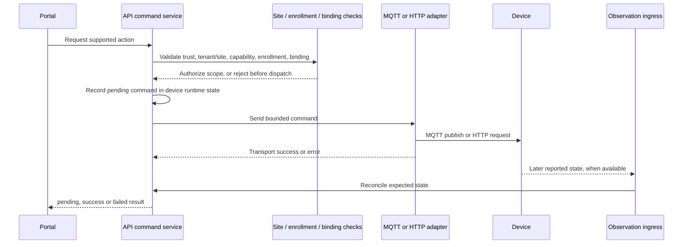

# Commands, authorization and audit

## Control path

The API's `DeviceControlService` accepts the implemented binary switch actions (`turn_on`, `turn_off`). Other recognized capability actions are not wired to a control adapter and are rejected before transport. For an executable action, the API checks that the device exists, is approved, matches the configured current tenant/site, supports the action, has a ready adapter binding and has an active enrollment. Group control also validates every member and detects cycles before sending commands.

The adapter sends a Shelly RPC payload over its configured MQTT or HTTP binding, or a generic MQTT command payload. The command enters a pending state before transport. Transport success moves it to published; MQTT control remains pending until a later state observation confirms the expected value. Transport errors are marked failed. An HTTP adapter may return an immediate state, which is ingested as an observation; a matching value confirms the result. “Published” means transport accepted the message, not that the actuator changed state.

## Authorization boundary

- Portal authentication and site context are enforced server-side. The browser does not choose an arbitrary tenant/site scope for control.
- A discovery candidate is not a control target until approval, active enrollment and a valid binding exist.
- Inferred reachability, publisher identity, physical inventory and logical enrollment are separate evidence and authorization states.
- Missing credentials, transport binding or unsupported action fail closed; no command should be sent when a prerequisite fails.

## Audit and retention limits

Do not call the current control trail a durable command audit. Device runtime command state lives in the registry and is not a durable append-only command ledger. `OperationalLogService` is an in-memory bounded ring (default 500 general entries, plus bounded per-device MQTT-stage entries). The PostgreSQL `auth.audit_events` table records authentication audit events; it is not wired as a device-command audit sink. MQTT publisher attribution is a separate broker-evidence record, not a record of user authorization or command outcome.

This means a restart can remove recent operational-log context, and the checked-in code does not establish a durable, user-attributed, tamper-evident command history. Treat a durable device-command audit ledger, its retention/access policy and integration with authenticated actor context as an open architecture gap before claiming regulated or safety-grade audit coverage.

## Related references

- [Portal authentication](portal-authentication.md)
- [Device model and lifecycle](device-model-lifecycle.md)
- [Device control notes](device-control.md)
- [Mosquitto publisher attribution](../deploy/mosquitto/README.md)

Implementation anchors: [device control service](../apps/api/src/app/modules/devices/device-control.service.ts), [device control bindings](../apps/api/src/app/modules/devices/bindings/device-binding.registry.ts), and [bounded in-memory operational log](../apps/api/src/app/modules/devices/operational-log.service.ts).
