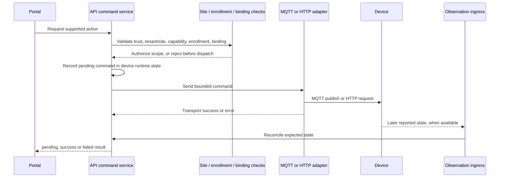

# Commands, authorization and audit

## Control path

The API's `DeviceControlService` accepts the implemented binary switch actions (`turn_on`, `turn_off`). Other recognized capability actions are not wired to a control adapter and are rejected before transport. For an executable action, the API checks approval, active enrollment, tenant/site ownership, switching capability, explicit permission and route readiness. The scope-resolved Shelly binding selects an execution transport from verified site-owned identity, component, active endpoint, configured scope and observer. Group control validates every member and detects cycles before dispatch.

The adapter sends a Shelly RPC payload over the resolved or explicitly configured route, or a generic MQTT command payload. The command enters a pending state before transport. Transport success alone is not settled success: fresh matching state readback is required. Transport errors are reported failed or uncertain according to the adapter result. Stale or mismatched readback cannot confirm the requested state.

## Authorization boundary

- Portal authentication and site context are enforced server-side. The browser does not choose an arbitrary tenant/site scope for control.
- A discovery candidate is not a control target until approval, active enrollment and a valid binding exist.
- Inferred reachability, publisher identity, physical inventory and logical enrollment are separate evidence and authorization states.
- Missing credentials, transport binding or unsupported action fail closed; no command should be sent when a prerequisite fails.
- Capability, enrollment, explicit per-component switching permission and executable route readiness are separate checks. Measurement approval and assistant permission remain separate. Read-only status collection does not grant switching authority.
- Historical endpoint observations do not silently select a route. A current endpoint must match the active configured site scope and authorized observer. The Home route validation failures observed on 2 November 2026 are listed in the backlog; no physical command was sent.
- Home site-local Shelly switching requires a separate exact command-route authorization in `HOME_SITE_LOCAL_SHELLY_CONTROL_ROUTES_JSON`, matched on tenant, site, scope, observer, physical ID and component. This configuration does not grant switching permission: the approved component's existing permission is still checked independently. The read-only observer cannot execute commands by virtue of its observation assignment. The fixed SSH adapter accepts only the resolved switch operation, verifies the observer interface/CIDR and Shelly ID/component, and requires fresh RPC state readback. No general shell command or direct browser-to-device route is exposed.
- On 3 November 2026, the local Home runtime loaded the exact Bathroom Plus 1 `switch:0` route through observer `pi-upstream-bathroom`; the authenticated Portal's read-only status action returned `Off` from `192.168.1.219`. The virtual Lab Portal also confirmed both `OFF` and `ON` requested through Energrid against Shelly `shellyplus1-00c0de000002`, with the emulator independently reporting the resulting values. This verifies virtual command/readback only. No physical Home `Switch.Set` has been issued; physical load safety confirmation and operator authorization are still required.

## M1.2 command failure identity (locally tested)

For a started command, pre-write failures, failed fresh readback, and publish transport failures now transition the **same command ID**, preserving its request timestamp and execution trace. A late failure for a superseded or acknowledged command cannot overwrite the current display state. Diagnostic categories distinguish pre-write rejection, verification mismatch, and transport failure. A failure to obtain readback after an attempted write remains **uncertain/pending**; it is not reclassified as a confirmed failed switch action.

Focused tests, API TypeScript checking, and documentation build passed locally on 4 November 2026. Physical hardware behavior remains unverified. The in-memory command sequence prevents same-millisecond ID collisions within a process; these IDs are not durable restart-proof command identifiers. It does not introduce durable command auditing or authenticated principal propagation. An HTTP adapter exception after a potential write can still leave the physical outcome uncertain; that ambiguity needs a separate explicit transport-outcome review.

## Audit and retention limits

Do not call the current control trail a durable command audit. Device runtime command state lives in the registry and is not a durable append-only command ledger. `OperationalLogService` is an in-memory bounded ring (default 500 general entries, plus bounded per-device MQTT-stage entries). The PostgreSQL `auth.audit_events` table records authentication audit events; it is not wired as a device-command audit sink. MQTT publisher attribution is a separate broker-evidence record, not a record of user authorization or command outcome.

This means a restart can remove recent operational-log context, and the checked-in code does not establish a durable, user-attributed, tamper-evident command history. Treat a durable device-command audit ledger, its retention/access policy and integration with authenticated actor context as an open architecture gap before claiming regulated or safety-grade audit coverage.

The in-memory execution trace retains the caller-supplied actor rather than replacing it with a service identity; absent actor information still displays as a system action. M1.1 was verified by 13 focused command-lifecycle tests, the API typecheck and the documentation build. M1.3 extends this to authenticated Portal commands, but other callers may still lack an attributable identity, and physical runtime behavior remains unverified.

## M1.3 Portal command attribution (source-level, verification pending)

The authenticated Portal action controller now derives the requesting actor from the JWT-authenticated server-side principal, not browser-supplied command fields. The stable `userId` reaches command traces for the site-local, Virtual Lab, HTTP and MQTT switching paths and is supplied as the actor for the Portal installation-event records. Unauthenticated or malformed principals are rejected before a command is recorded or attempted. Group control forwards the same actor to member commands.

This changes **attribution, not authority**: site selection, enrollment, component permission and route validation remain separate required checks. Direct service callers that do not supply an actor still use the command tracker's system fallback; assistant and automation identity are not established by this change. The trace and installation-event storage are **not** a durable tamper-evident user audit ledger. Runtime/device validation remains outstanding.

### Scoped command state (M1.4c — locally unverified)

Command state and execution traces now use the tenant/site/device identity, rather than a bare logical device ID. Pending commands receive ownership from the enrolled `RegisteredDevice` in the control service; accepted telemetry must carry its own trusted scope to verify or change a command. Portal execution traces are filtered by the authorized site, including when logical IDs are reused. The tracker requires explicit ownership for command creation, state lookup, and trace listing; scope-less calls fail type checking rather than silently selecting the Home installation.

This is an in-memory runtime correction, not a durable or tamper-evident audit ledger. Publication and failure callbacks still correlate by the unique command ID and device ID, and observation ingress scope authority must be verified separately. Focused tests, API typecheck, documentation build and physical behavior must be validated in the target checkout before this change is accepted.

## Related references

- [Portal authentication](portal-authentication.md)
- [Device model and lifecycle](device-model-lifecycle.md)
- [Device control notes](device-control.md)
- [Mosquitto publisher attribution](../deploy/mosquitto/README.md)

Implementation anchors: [device control service](../apps/api/src/app/modules/devices/device-control.service.ts), [device control bindings](../apps/api/src/app/modules/devices/bindings/device-binding.registry.ts), and [bounded in-memory operational log](../apps/api/src/app/modules/devices/operational-log.service.ts).
