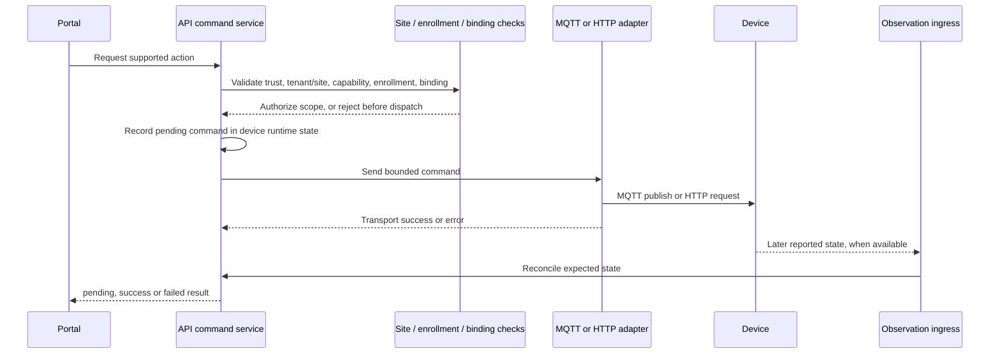

# Commands, authorization and audit

## Control path

The API's `DeviceControlService` accepts the implemented binary switch actions (`turn_on`, `turn_off`). Other recognized capability actions are not wired to a control adapter and are rejected before transport. For an executable action, the API checks approval, active enrollment, tenant/site ownership, switching capability, explicit permission and route readiness. The scope-resolved Shelly binding selects an execution transport from verified site-owned identity, component, active endpoint, configured scope and observer. Group control validates every member and detects cycles before dispatch.

The adapter sends a Shelly RPC payload over the resolved or explicitly configured route, or a generic MQTT command payload. The command enters a pending state before transport. Transport success alone is not settled success: fresh matching state readback is required. Transport errors are reported failed or uncertain according to the adapter result. Stale or mismatched readback cannot confirm the requested state.

## Authorization boundary

- Portal authentication and site context are enforced server-side. The browser does not choose an arbitrary tenant/site scope for control.
- A discovery candidate is not a control target until approval, active enrollment and a valid binding exist.
- Inferred reachability, publisher identity, physical inventory and logical enrollment are separate evidence and authorization states.
- Missing credentials, transport binding or unsupported action fail closed; no command should be sent when a prerequisite fails.
- Capability, enrollment, explicit per-component switching permission and executable route readiness are separate checks. Measurement approval and assistant permission remain separate. Read-only status collection does not grant switching authority.
- Historical endpoint observations do not silently select a route. A current endpoint must match the active configured site scope and authorized observer. The Home route validation failures observed on 2 November 2026 are listed in the backlog; no physical command was sent.
- Home site-local Shelly switching requires a separate exact command-route authorization in `HOME_SITE_LOCAL_SHELLY_CONTROL_ROUTES_JSON`, matched on tenant, site, scope, observer, physical ID and component. This configuration does not grant switching permission: the approved component's existing permission is still checked independently. The read-only observer cannot execute commands by virtue of its observation assignment. The fixed SSH adapter accepts only the resolved switch operation, verifies the observer interface/CIDR and Shelly ID/component, and requires fresh RPC state readback. No general shell command or direct browser-to-device route is exposed.
- On 3 November 2026, the local Home runtime loaded the exact Bathroom Plus 1 `switch:0` route through observer `pi-upstream-bathroom`; the authenticated Portal's read-only status action returned `Off` from `192.168.1.219`. The virtual Lab Portal also confirmed both `OFF` and `ON` requested through Energrid against Shelly `shellyplus1-00c0de000002`, with the emulator independently reporting the resulting values. This verifies virtual command/readback only. No physical Home `Switch.Set` has been issued; physical load safety confirmation and operator authorization are still required.

## Audit and retention limits

Do not call the current control trail a durable command audit. Device runtime command state lives in the registry and is not a durable append-only command ledger. `OperationalLogService` is an in-memory bounded ring (default 500 general entries, plus bounded per-device MQTT-stage entries). The PostgreSQL `auth.audit_events` table records authentication audit events; it is not wired as a device-command audit sink. MQTT publisher attribution is a separate broker-evidence record, not a record of user authorization or command outcome.

This means a restart can remove recent operational-log context, and the checked-in code does not establish a durable, user-attributed, tamper-evident command history. Treat a durable device-command audit ledger, its retention/access policy and integration with authenticated actor context as an open architecture gap before claiming regulated or safety-grade audit coverage.

The in-memory execution trace now retains the actor supplied by its command caller rather than replacing it with a service identity; absent actor information still displays as a system action. This is **not** end-to-end authenticated actor attribution: some Portal control paths currently supply a placeholder `portal-installer` identity and others omit an actor. The authenticated principal must be propagated explicitly in a separate reviewed change before a trace is evidence of the requesting user. This is a source-level correction only, pending focused tests in a complete checkout.

## Related references

- [Portal authentication](portal-authentication.md)
- [Device model and lifecycle](device-model-lifecycle.md)
- [Device control notes](device-control.md)
- [Mosquitto publisher attribution](../deploy/mosquitto/README.md)

Implementation anchors: [device control service](../apps/api/src/app/modules/devices/device-control.service.ts), [device control bindings](../apps/api/src/app/modules/devices/bindings/device-binding.registry.ts), and [bounded in-memory operational log](../apps/api/src/app/modules/devices/operational-log.service.ts).
