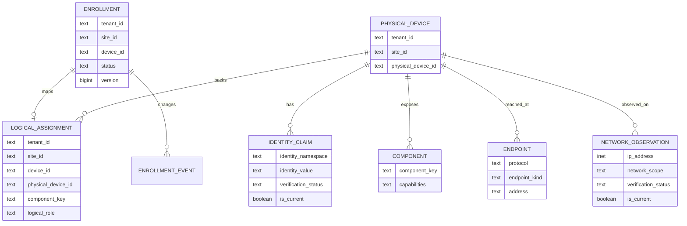

# Device model and lifecycle

## Scope first

The current inventory and enrollment contracts carry `tenantId`, `siteId` and a logical `deviceId`. These are scope values in the checked-in schema; the migrations shown here do not create tenant or site master tables. Cross-site work must preserve both tenant and site scope.

## Logical device and physical inventory

An **enrollment** is the logical, site-scoped authorization record. It has a display name, status, version and enrollment timestamps. It is explicit; discovery does not automatically enroll a device. Supported transitions include enroll, suspend, reactivate, retire and reenroll; state changes carry an actor and event ID, and the PostgreSQL adapter writes state plus event in one transaction with optimistic version checking.

A **physical device** is a protocol-independent asset record. It can have identity claims, components, endpoints and network observations. An identity claim records namespace/value, evidence source and verification status (`protocol_observed`, `user_confirmed`, or `hardware_verified`). A protocol-observed claim does not by itself mean a human confirmed the asset.

A **component** is a physical-device component with a stable component key and capabilities. A **logical component assignment** associates an enrolled logical device with a physical device and optionally one component key and role. This is the explicit bridge between control/telemetry-facing logical IDs and physical assets. The schema permits one assignment per logical enrollment; component-bearing assignments are unique per physical component.

Relationships correspond to composite tenant/site-scoped foreign keys in the migration, not a global cross-site identity graph. `logical_component_assignments.component_key` is nullable, so an assignment can target a physical device without selecting a component.

Implementation anchors: [enrollment migration](../apps/core/migrations/1792391460218_device-enrollment-v1.js), [physical inventory migration](../apps/core/migrations/1792470000000_physical-device-inventory-v1.js), [enrollment domain library](../libs/domain-devices/src/lib/device-enrollment.ts), and [PostgreSQL enrollment adapter](../apps/api/src/app/modules/devices/enrollment/postgres-device-enrollment.repository.ts).

## Lifecycle stages

1. **Discovery** records candidate/reachability and protocol evidence in API discovery memory and, for physical inventory flows, PostgreSQL. ICMP, ARP, router and MQTT publisher evidence are not interchangeable identity proofs.
2. **Identity verification** checks a stable protocol identity against a physical identity claim within site/network scope. HTTP candidates use `GET /api/v1/identity`; a mismatch or stale identity prevents the observation adapter from trusting the endpoint.
3. **Enrollment** is an explicit action. Enrollment is independent of discovery, observation admission and connectivity. Its status and event history are persisted in PostgreSQL.
4. **Assignment** connects the enrolled logical ID to a physical device/component. The inventory repository enforces scope, identity uniqueness and assignment constraints.
5. **Observation admission** requires trusted installation and authorization context. State projection is separate from physical identity; rejected or duplicate evidence is recorded as a decision in the observation store.
6. **Control** additionally checks approved trust, site scope, active enrollment, supported action and a ready adapter binding. An approved MQTT observation or verified HTTP identity does not alone authorize a command.

## Multi-component Shelly inventory (local main `dbf63c26`)

The Portal's Devices view counts physical units separately from logical components. It groups rows only from the authenticated site's enrollment `physicalAssignments`, matched by exact component key and physical inventory ID. A missing, ambiguous or conflicting assignment is displayed as an unlinked row; matching Shelly protocol IDs alone never merge records. For a Pro 2PM, `switch:0` and `switch:1` are separate logical components under one physical inventory record when both assignments point to that same record. Each component retains its own room, capability, observation state and control permission.

The Portal read-only status action supports a component key such as `switch:N`. The API resolves the enrolled component, physical inventory, current site-owned endpoint, configured network scope and observer before contacting a device. It validates identity and component status, then writes operational state through the existing registry state path. It does not enroll a device or grant measurement, switching or assistant authority. A saved historical endpoint is not sufficient if it is outside the installation's currently configured scope. A 409 scope rejection means the RPC was not sent.

**Observed Home Portal result on 2 November 2026:** local main `dbf63c26` displayed 6 physical devices and 7 components. The Pro 2PM's `switch:0` and `switch:1` shared Physical Inventory `8e15ec60-a22b-4f8c-ab09-5e61d44030f9`. `switch:0` displayed existing power/current state; `switch:1` retained historical component evidence but had no fresh state. A read-only `switch:1` status request returned HTTP 409 because the saved endpoint was not accepted by the current configured installation scope. No RPC or relay command followed. The two Plus 1 units appeared in the Portal, but their saved endpoint evidence also failed current route validation. This is a local authenticated Portal observation, not production deployment evidence.

## Status and authority are separate

Discovery status, physical identity verification, logical enrollment, trust/approval, observation admission, connectivity and health are distinct concepts. For example, a device can be discoverable but unenrolled; a device can be enrolled while currently unreachable; a recent sample can be fresh without proving command capability. See [observation pipelines](observation-pipelines.md) and [commands and authority](commands-and-authority.md).

## Restoring LAN-verified Add Devices candidates

The authenticated Portal state projection rebuilds pending Shelly candidates from the current tenant/site's persisted Discovery Memory records. A record is eligible only when it contains a timestamped Shelly RPC device ID that exactly matches the record's physical ID, plus a separate read-only status response for each component. Conflicted identities and unsupported components are excluded. The existing registry suppresses candidates whose logical identity is already approved. The candidate retains its source and observation timestamps; this restoration does not enroll it or grant measurement or control authority.

The Shelly ID is protocol evidence, not independent hardware authentication. Fresh identity and component evidence is still required for onboarding actions that require it. The projection uses [Shelly LAN candidate mapping](../apps/api/src/app/modules/devices/adapters/inbound/shelly/shelly-lan-candidates.ts), [Discovery Memory](../apps/api/src/app/modules/devices/device-discovery-memory.store.ts), and the authenticated [Portal state projection](../apps/api/src/app/modules/portal/portal.controller.ts).

### Selected-device verification through the Virtual Device Lab

The Virtual Device Lab's selected-device verification runs read-only Shelly RPC through the configured remote Docker observer used by Lab discovery; the API host does not need a route to the Lab VLAN. The API accepts the route only for an enabled configured Virtual Lab scope, a target resolved from persisted site-owned candidate/enrollment evidence and inside that scope, and the configured authenticated Docker context/observer. The fixed, non-root, read-only runner requests `Shelly.GetDeviceInfo`, paged `Shelly.GetComponents`, and status for the expected component set within bounded deadlines. The API validates physical ID, generation, component profile and status response before recording server-timestamped evidence in Discovery Memory and updating Physical Inventory. Subnet discovery is separately bounded to the authorized scope; adding a device to discovery does not add its address to an API seed list.

This Lab path can establish the first physical-inventory record only after those RPC checks pass; it does not treat the scan's protocol claim as LAN verification. For existing devices, the normal site-owned inventory identity and component-assignment checks remain in force. Successful verification refreshes the review candidate and its evidence timestamps, but does not enroll, approve measurements, or authorize control. Virtual Lab switch status alone does not imply power or energy capability. The adapter and verifier are [Virtual Lab network evidence](../apps/api/src/app/modules/devices/adapters/outbound/network/virtual-lab-network-evidence.adapter.ts) and [selected Shelly verification](../apps/api/src/app/modules/devices/device-lan-discovery.service.ts); this documented boundary describes the implementation, not a claim that a particular live Portal run has completed.
