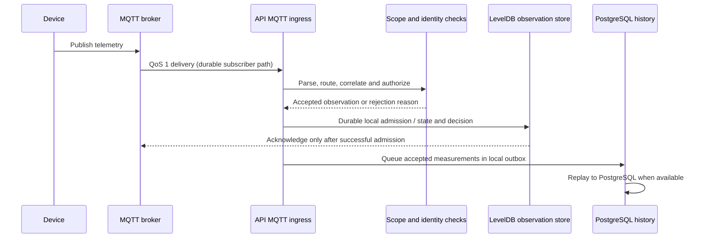
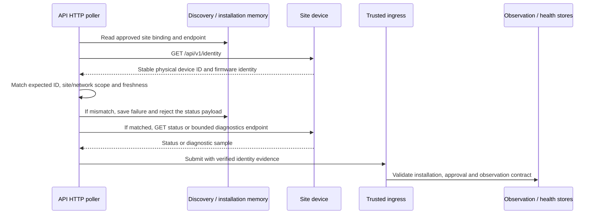

# Observation and identity flows

This page describes the repository implementation at the documentation base commit. It does not define firmware guarantees beyond the API's accepted contracts.

## MQTT ingestion

The API's device MQTT path is distinct from the telemetry subsystem's durable subscriber. The device path parses configured topics, routes recognized payloads, gathers evidence, checks site/install binding and approval, then admits observations through the domain pipeline. A separate persistent MQTT subscriber uses a stable client ID, `clean: false`, QoS 1 subscriptions and acknowledges delivery only after its callback reports successful local durable admission; on admission failure it closes without acknowledging so the broker session may redeliver.

The diagram combines the durable-subscriber contract with the approved observation/history path; not every MQTT topic or device protocol enters each stage. Do not infer broker delivery guarantees for QoS 0. The bounded in-memory operational log is diagnostic context, not the durable observation record.

An optional Mosquitto publisher-attribution plugin sends signed broker evidence to a dedicated topic. It records publisher metadata and a payload digest rather than retaining payloads. API-side HMAC and timestamp checks are required; candidate peer addresses require additional bounded Shelly RPC identity evidence before they can be promoted as verified LAN addresses. See [the plugin guide](../deploy/mosquitto/README.md).

## HTTP polling and identity verification

The API poller operates on approved installations, reads the endpoint binding from site-scoped discovery memory and refreshes a stable HTTP identity. It does not trust a new IP merely because the address responded. The current Energrid identity contract uses `GET /api/v1/identity`; the poller requires the expected physical `deviceId` and records scope/method/time identity evidence. Only a fresh, exact match can authorize the observation adapter to use the existing endpoint for status observations. Stale evidence triggers identity renewal; mismatch, failed request, invalid endpoint or scope mismatch rejects the observation path.

Status observation and firmware diagnostics have different schemas and persistence paths. The V1 firmware diagnostics endpoint is `GET /api/v1/diagnostics`; the parser accepts a bounded schema version and exact expected physical ID. Samples have a collector timestamp (`collectedAt`); firmware currently supplies no trusted wall-clock sample time, so `deviceObservedAt` is null. Communication failures are retained as failures; they do not prove that the device is offline.

## Rejection and recovery

- Unknown, stale, mismatched or out-of-scope identity is rejected; renew evidence before retrying.
- Duplicate observation evidence is deduplicated by scoped identity/evidence ID. Reuse of an evidence ID with different content is a conflict, not a new reading.
- Local durable admission failure pauses MQTT acknowledgement and allows broker redelivery for the persistent QoS 1 session. After restart, local state is reopened and queued history replay is retried.
- PostgreSQL history outage leaves admitted measurements in the bounded LevelDB outbox; when the queue reaches capacity, ingress fails closed instead of silently evicting queued measurements.
- Network/HTTP failure records a collection attempt and reason. It does not synthesize an offline observation.

For stored history and retention behavior, see [persistence](persistence.md), [Device Health history](device-health-history.md), and [generic measurement history](../apps/api/src/app/modules/telemetry/generic-measurements/README.md).

Implementation anchors: [durable MQTT subscriber](../apps/api/src/app/modules/devices/mqtt/durable-mqtt-subscriber.ts), [approved MQTT observation runtime](../apps/api/src/app/modules/devices/mqtt/approved-mqtt-observation.runtime.ts), [HTTP poller](../apps/api/src/app/modules/devices/device-http-poll.service.ts), [HTTP observation adapter](../apps/api/src/app/modules/devices/adapters/inbound/energrid/energrid-http-observation.adapter.ts), and [firmware diagnostics store](../apps/api/src/app/modules/devices/device-firmware-diagnostics.ts).
