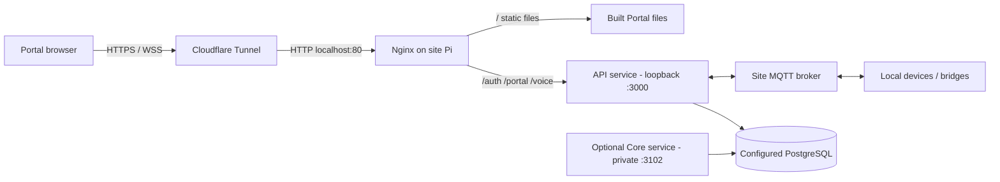

# Operations and deployment

## Local application commands

Install the repository's pinned workspace dependencies with `pnpm install`. The root scripts include:

| Command | Purpose |
| --- | --- |
| `pnpm api` | Serve the API through Nx. |
| `pnpm core` | Serve Core through Nx. |
| `pnpm portal` | Serve the Portal with its configured proxy defaults. |
| `pnpm portal:local` | Portal configured for a local API at port 3000. |
| `pnpm core:migrate:status` | Read migration status for the configured Core database. |
| `pnpm auth:dev:setup` | Create local development authentication setup. |
| `pnpm docs:dev` | Preview this documentation site at localhost. |
| `pnpm docs:build` | Build the static documentation site. |
| `pnpm docs:preview` | Preview the generated documentation build. |

Application commands can connect to PostgreSQL, MQTT, devices or external providers depending on environment variables. Documentation validation should use only `docs:build`; confirm the selected environment before using application or migration commands.

## Configuration

`.env.example` lists many current configuration inputs but is not a complete deployment specification. The API/Core can have separate environment files and independently configured database connections. Do not commit secrets. Keep device control, broker credentials, API tokens and provider keys in protected runtime configuration.

For durable local operation, configure absolute persistent LevelDB paths for enabled stores. In particular, `HOME_OBSERVATION_STORE_DIRECTORY` is required when HTTP or MQTT observation ingestion is enabled; `TELEMETRY_SPOOL_DIRECTORY` is required when electrical telemetry is enabled. See [persistence](persistence.md) for defaults and ownership.

## Deployment references in this repository

- `deploy/site-gateway/` contains sample device configuration JSON, including mixed MQTT/HTTP and HTTP-polled examples.
- `deploy/mosquitto/` contains the optional broker publisher-attribution plugin, sample config/ACL and build notes. The README documents a missing Pi header-package prerequisite and explicitly calls for a separate deployment window; this handbook does not install it.
- `deploy/nginx/energrid-portal.conf` is a checked-in Nginx example.
- `docs/portal-cloudflare-pi-deploy.md`, `docs/site-gateway-bootstrap.md`, `docs/mac-lab-persistence.md`, and `docs/voice-pi-browser-deploy.md` are environment-specific procedures. Review their dates, assumptions and local credentials before reuse.

These checked-in examples do not establish the live configuration of any Pi, Mac LAB, broker, router or physical device. This documentation work does not access or alter those systems.

## Example Pi topology from the checked-in deployment guide

The diagram records the shape described by `docs/portal-cloudflare-pi-deploy.md`; it is a documented target/example, not a verified live topology. The Core service is optional and remains private in that guide.

## Safe troubleshooting sequence

1. Confirm which API/Core process and site scope are intended.
2. Inspect the API's status/diagnostic routes and bounded operational logs; remember operational logs are in-memory and can disappear on restart.
3. For MQTT, check broker connection/subscription status, topic/route decisions, durable observation admission and outbox replay separately.
4. For HTTP, confirm the approved endpoint binding and latest identity verification. Do not treat an IP response alone as a verified identity.
5. Check enrollment, physical-to-logical assignment, observation authorization and command binding as separate state.
6. Before any migration or rollout, verify the target database/environment and follow the relevant environment-specific procedure. A docs task never requires a live migration.

For a remote Shelly scope, the local API Run console should show `[REMOTE SHELLY OBSERVER] started` with the authorized observer ID and scope, followed by the structured `remote_shelly_operational_observation` marker after a response passes validation and is submitted to the canonical registry writer. The marker contains device/component, observer, scope, observation ID and timestamp, but no device payload or credentials. A running remote Node child alone proves only process startup; match the marker's timestamp to the authenticated Portal state before claiming the worker delivered a sample. The API owns the SSH session and retries it after exit; no Pi service installation or inbound API port is part of this path. Do not pause or signal an observer outside a planned, authorized recovery test.

Local runtime check, 3 November 2026: after the local API restarted, it recreated the authorized `pi-upstream-bathroom` session for Home / `upstream-lan` and logged status accepted by the canonical writer. The authenticated Portal's SSE connection was connected and its displayed Bathroom state timestamp advanced without reload. A worker pause alone did not make the component stale because a separate configured MQTT source continued to supply observations; only test stale behavior after confirming all accepted sources are stopped. This evidence is local development only and is not a production deployment.

For endpoint shapes, use the running API/Core OpenAPI docs as described in [API docs](api-docs.md). OpenAPI is runtime-generated and is not a replacement for the identity, persistence or authorization explanations in this handbook.
