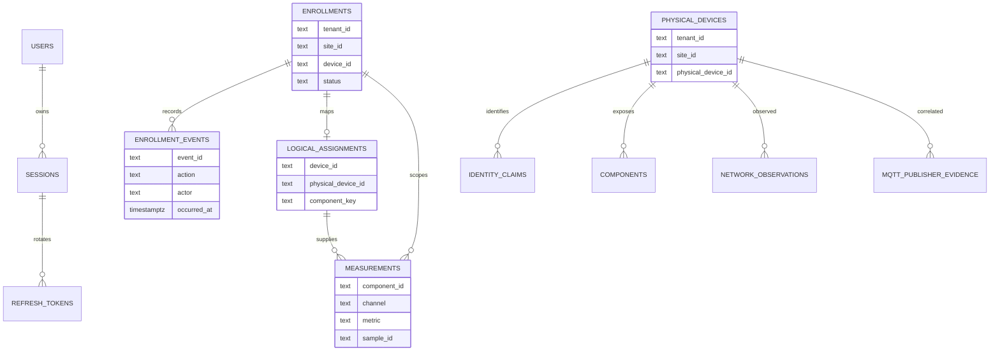

# Persistence map

This page distinguishes durable stores from runtime caches. It was derived from the checked-in migrations and store implementations; it does not inspect or modify a live database or local store.

## PostgreSQL

The checked-in migrations are under `apps/core/migrations`; they create multiple application schemas and tables. API and Core use separately configured database connections, and the code does not require them to point at the same database.

| Schema / tables | Purpose and key relationship |
| --- | --- |
| `auth.users`, `auth.sessions`, `auth.refresh_tokens`, `auth.audit_events`, rate-limit tables | Portal account/session lifecycle and authentication audit. Auth audit events are not device-command audit records. |
| `device_inventory.enrollments`, `enrollment_events` | Tenant/site/logical-device enrollment state and append-only transition events. Composite key `(tenant_id, site_id, device_id)`; event rows reference the enrollment. |
| `device_inventory.physical_devices`, `physical_device_identity_claims`, `physical_device_components`, `physical_device_endpoints`, `physical_device_network_observations` | Scoped physical inventory and identity/network evidence. Current identity claims are unique within scope/namespace/value; evidence distinguishes protocol-observed from user- or hardware-verified association. |
| `device_inventory.logical_component_assignments` | Connects an enrollment to a physical device and optional component. Composite foreign keys enforce matching tenant/site scope. |
| `device_inventory.mqtt_publisher_evidence` | Broker publisher metadata, digest and verification state; links to physical inventory where correlated. Migration adds time-history indexes and retention support. |
| `telemetry.measurements` | Generic accepted historical measurements keyed by tenant/site/device/component/channel/metric/sample ID; references enrollment and physical assignment. Numeric validity, quality and timestamp constraints are checked in PostgreSQL. |
| `telemetry.readings`, `dirty_hours`, `hourly` | Electrical telemetry history and dirty rollup work, created by the electrical telemetry migration. |
| `personal_finance.merchants`, `expense_drafts`, `expenses`, `expense_items`, `expense_draft_items`, `receipts`, `provenance_events` | Account-scoped personal finance history, draft confirmation, receipt metadata and append-only provenance. Money uses `numeric(38,18)` and source/import keys are unique within the account. |
| Forecast, weather, pricing, estimator and installation tables | Core application persistence created in the earlier migrations. Consult migration files for exact table names and constraints before changing them. |

This is a focused relationship view, not a complete ERD. Weather and estimator tables are omitted. Table definitions and constraints are in the corresponding migration, not inferred from this diagram.

## LevelDB and local durable stores

Most stores are opened by the API process with `classic-level` and JSON encoding. Keep their directories writable and persistent for the service account. Do not copy, delete, inspect or migrate a live production database as part of documentation work.

| Store | Default / configuration | Key families or ownership |
| --- | --- | --- |
| Device installation and site registry | `~/.energrid/device-registry`; override `HOME_DEVICE_STORE_DIRECTORY` | `installation:<site>:<device>`, scoped `portal-site:<tenant>:<site>`, and `portal-site-selection:<user>` records. |
| Network discovery memory | `~/.energrid/network-discovery`; override `HOME_DISCOVERY_MEMORY_DIRECTORY` | Scoped device/endpoint observations, summaries and `snapshot:<scanId>` scan snapshots. It is discovery memory, not the enrollment database. |
| Approved observation state | `HOME_OBSERVATION_STORE_DIRECTORY` is required when approved MQTT or HTTP observation ingestion is enabled | Scoped state/revisions, per-device decisions, source cursors and evidence-ID deduplication index; accepted state and decision history are batch-written together. |
| Firmware diagnostics and Device Health history | `~/.energrid/device-firmware-diagnostics`; override `HOME_FIRMWARE_DIAGNOSTICS_DIRECTORY` | Scoped current diagnostics and `raw`, `hourly`, `daily`, event, failure, marker and migration metadata key families. Health V1 retention is configurable; see [its guide](device-health-history.md). |
| Electrical telemetry spool | `TELEMETRY_SPOOL_DIRECTORY` (absolute path required when `TELEMETRY_ENABLED=true`) | Local durability before electrical telemetry is flushed to PostgreSQL. |
| Generic measurement history outbox | `~/.energrid/measurement-history-outbox`; override `TELEMETRY_HISTORY_OUTBOX_DIRECTORY` | Admitted generic measurements waiting for PostgreSQL replay; capacity is `TELEMETRY_MAX_PENDING_WRITES`, and queued history is not evicted. See [the module guide](../apps/api/src/app/modules/telemetry/generic-measurements/README.md). |
| Device investigation history | `~/.energrid/device-investigations`; override `ENERGRID_INVESTIGATION_STORE_DIRECTORY` | Investigation records, scoped device indexes, action records and profile history. |
| MQTT captured evidence | `HOME_MQTT_EVIDENCE_STORE_DIRECTORY` | Optional bounded, explicitly topic-bound payload evidence store; configured bindings are scoped and disabled unless supplied. |
| Personal expenses | `~/.energrid/personal-expenses`; override `ENERGRID_PERSONAL_EXPENSES_DIRECTORY` | Account-scoped `record`, date index and legacy-source index keys. The API derives ownership from the authenticated account; the Portal cannot select another owner's data. |

There are additional short-lived in-memory structures, including the basic observation/health snapshot service, device registry state, operational logs and correlation caches. The basic `DeviceHealthService` computes healthy/degraded/stale from recent in-memory observations; it is distinct from the persisted firmware diagnostics timeline in Device Health history V1.

## Migration and recovery rules

- Review the numbered migration before applying or rolling it back. Core migration commands read database configuration; do not run them against production as a docs check.
- Enrollment and its event are committed in one PostgreSQL transaction. A failed write rolls back both; concurrent version conflicts are rejected.
- Observation LevelDB writes batch state, decision, evidence deduplication and bounded decision retention. An uncertain LevelDB write poisons the store instance until reopened rather than continuing from ambiguous state.
- Generic measurement outbox entries remain queued through PostgreSQL outages and replay after startup/on interval. Full or unavailable local durable admission returns an error to the source.
- Firmware-health retention and migration happen as writes occur; startup does not destructively rewrite existing local records.
- Personal finance V2 confirms a draft, its line items, receipt links and provenance in one transaction; imports also use one transaction per submitted batch. The legacy LevelDB expense store remains available to V2 reads during migration.

## Schema source of truth

Use `apps/core/migrations/*.js` for PostgreSQL table/constraint contracts and the repository adapter for read/write behavior. Use each LevelDB store implementation for key layout and retention. This handbook's table is an index, not a substitute for reviewing a migration before schema changes.
